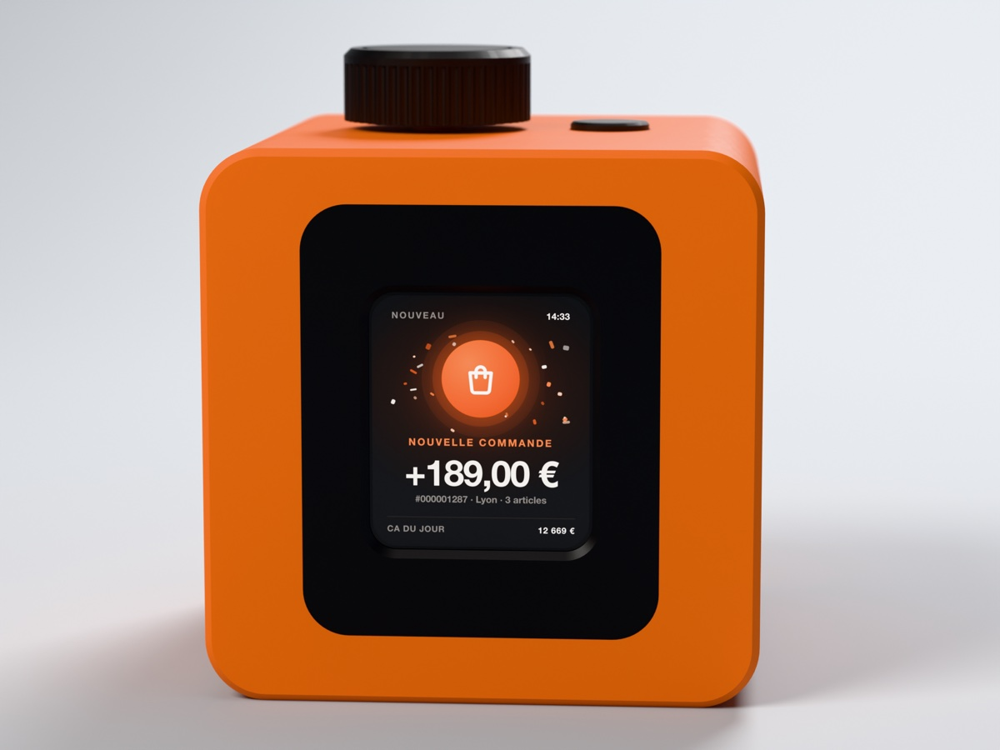

# ClickAndMortar_Cube: live sales stats for the Cube Magento

<p align="center">
  
</p>

Magento 2 module by [Click&Mortar](https://www.clickandmortar.fr) that exposes today's sales aggregates through a
read-only REST API. It feeds the **Cube Magento**, a 3D-printed desk cube with a small screen that shows today's
revenue, order count and average order value, and plays an animation and a beep on every new order.

> [!IMPORTANT]
> **No personal data is ever exposed.** The API returns aggregates (revenue, order counts, averages) and, for each
> order, only its ID, amount, item count, creation date and **city**. Customer names, email addresses, street
> addresses, postcodes, phone numbers, payment details and IP addresses are never read into the response. The
> integration token can reach nothing else: its only ACL resource is `ClickAndMortar_Cube::stats`, which grants no
> access to orders, customers or any other Magento API. The end-to-end test inserts orders with a known name, email
> and street address, and fails if any of them shows up in a response.

- `GET /rest/V1/cm-cube/stats`: today's revenue and orders, comparison with yesterday at the same time, last 7 days,
  daily goal, record, last order.
- `GET /rest/V1/cm-cube/events?since=<entity_id>`: new orders since an ID, with "first order of the day" and
  "record broken" flags.

Everything is computed server-side with aggregated SQL queries; no order collection is ever loaded.

## Compatibility

| Magento Open Source | PHP | Database | OpenSearch | Result |
|---|---|---|---|---|
| 2.4.6-p15 | 8.2.35 | MariaDB 10.6 | 2.19.3 | ✅ 24 unit tests (PHPUnit 9.6) + end-to-end API test (110 assertions) |
| 2.4.8-p5 | 8.3.36 | MariaDB 11.4 | 2.19.3 | ✅ same (PHPUnit 10.5) |
| 2.4.9 | 8.4.27 | MariaDB 11.4 | 2.19.3 | ✅ same (PHPUnit 12.5) |

Tested on 2026-11-16 with the `docker/` bench (Magento Open Source downloaded from the Mage-OS mirror, which ships the
same code as repo.magento.com). 2.4.7 was not tested but sits between two validated versions. Adobe Commerce and
Mage-OS should work (same `sales_order` tables) but have not been tested.

PHPCS (`Magento2` standard from magento/magento-coding-standard): 0 errors.

## Installation

The module is not on Packagist: declare this GitHub repository in your store's `composer.json`.

```bash
composer config repositories.cm-cube vcs https://github.com/ClickAndMortar/magento2-module-cube
composer require clickandmortar/module-cube:^1.0
bin/magento module:enable ClickAndMortar_Cube
bin/magento setup:upgrade
# in production mode:
bin/magento setup:di:compile && bin/magento setup:static-content:deploy -f
```

## Access token for the cube

The cube authenticates with an **integration token** that carries a single ACL resource, `ClickAndMortar_Cube::stats`
("Click&Mortar Cube > Read cube statistics (API)"). It cannot read anything else.

### From the command line (recommended)

```bash
bin/magento cm-cube:integration:create              # creates "Cube Magento", activates it and prints the token
bin/magento cm-cube:integration:create --replace    # regenerates it (the previous token stops working)
bin/magento cm-cube:integration:create --token-only # prints the token only, for scripts
```

### From the admin

1. System > Extensions > Integrations > Add New Integration: name it "Cube Magento".
2. "API" tab: Resource Access "Custom", tick "Click&Mortar Cube" only.
3. Save, then "Activate" and "Allow": copy the **Access Token**.

### Allow the integration token as a Bearer token

Since Magento 2.4.4, an integration token is only accepted on its own in an `Authorization: Bearer` header when this
option is enabled:

```bash
bin/magento config:set oauth/consumer/enable_integration_as_bearer 1
```

or Stores > Configuration > Services > OAuth > Consumer Settings > "Allow OAuth Access Tokens to be used as standalone
Bearer tokens" = Yes. Without it, every request would have to be signed with OAuth 1.0a, which the cube firmware does
not do.

## Configuration

Stores > Configuration > Click&Mortar > Cube (default scope). Admin labels are in English, with a French translation
(`i18n/fr_FR.csv`).

| Field | Path | Default |
|---|---|---|
| Enable cube API | `cm_cube/general/enabled` | Yes (when disabled: 403 responses) |
| Enabled screens | `cm_cube/general/screens` | `today,compare,week,last_order,goal` |
| Daily revenue goal (base currency, 0 = none) | `cm_cube/general/daily_goal` | 0 (the `goal` screen is then removed from `screens`) |
| Timezone | `cm_cube/general/timezone` | `Europe/Paris` |
| Store views counted (empty = all) | `cm_cube/general/store_ids` | all |
| Excluded order states | `cm_cube/general/excluded_states` | `canceled` |
| Maximum events per call (1 to 100) | `cm_cube/advanced/events_limit` | 20 |
| Record window, in days (7 to 1095) | `cm_cube/advanced/record_window_days` | 365 |

## Examples

```bash
TOKEN=…   # integration token
curl -s -H "Authorization: Bearer $TOKEN" https://shop.example/rest/V1/cm-cube/stats
curl -s -H "Authorization: Bearer $TOKEN" "https://shop.example/rest/V1/cm-cube/events?since=0"
curl -s -H "Authorization: Bearer $TOKEN" "https://shop.example/rest/V1/cm-cube/events?since=1234&limit=5"
```

### `GET /V1/cm-cube/stats`

```json
{
  "generated_at": "2026-11-16T15:08:27+01:00",
  "timezone": "Europe/Paris",
  "currency": "EUR",
  "store_ids": [],
  "screens": ["today", "compare", "week", "last_order", "goal"],
  "today": {"revenue": 220, "orders": 3, "average_order": 73.33},
  "yesterday_same_time": {"revenue": 100, "orders": 2, "average_order": 50},
  "revenue_delta_pct": 120,
  "orders_delta_pct": 50,
  "goal_revenue": 1000,
  "goal_progress_pct": 22,
  "record_revenue": 2000,
  "record_date": "2026-11-07",
  "record_broken_today": false,
  "week": [
    {"date": "2026-11-10", "revenue": 0, "orders": 0},
    {"date": "2026-11-11", "revenue": 0, "orders": 0},
    {"date": "2026-11-12", "revenue": 0, "orders": 0},
    {"date": "2026-11-13", "revenue": 1500, "orders": 1},
    {"date": "2026-11-14", "revenue": 10, "orders": 1},
    {"date": "2026-11-15", "revenue": 600, "orders": 3},
    {"date": "2026-11-16", "revenue": 220, "orders": 3}
  ],
  "last_order": {
    "entity_id": 40, "increment_id": "000000040", "amount": 70, "city": "Bordeaux", "items": 3,
    "created_at": "2026-11-16T12:06:36+01:00"
  },
  "last_entity_id": 40
}
```

| Field | Meaning |
|---|---|
| `today` | Since midnight (configured timezone): revenue = sum of `base_grand_total`, in base currency, excluded states left out |
| `yesterday_same_time` | Yesterday, from midnight up to the same local time as now (23-hour and 25-hour DST days handled) |
| `revenue_delta_pct`, `orders_delta_pct` | Change in % vs yesterday at the same time, rounded to 0.1; `null` when yesterday = 0 |
| `goal_revenue`, `goal_progress_pct` | Goal and progress (may exceed 100); `null` without a goal |
| `record_revenue`, `record_date` | Best daily revenue within the window, today excluded; `null` when there are no sales |
| `record_broken_today` | Today's revenue already exceeds the record |
| `week` | 7 days, oldest first, today (day so far) last |
| `last_order` | Last counted order, any day; `null` when there is none |
| `last_entity_id` | Initial cursor for `/events` |

> [!WARNING]
> **`null` fields**: Magento 2.4.6 **omits** null fields from the JSON, while 2.4.7+ returns them as `null`. Clients
> must treat "missing" and `null` the same way.

### `GET /V1/cm-cube/events?since=<entity_id>&limit=<n>`

```json
{
  "events": [
    {
      "entity_id": 41, "increment_id": "000000041", "amount": 1400, "city": "Toulouse", "items": 1,
      "created_at": "2026-11-16T15:07:10+01:00", "first_of_day": false, "record_broken": true
    }
  ],
  "last_entity_id": 41,
  "skipped": 0
}
```

- `since=0` (first call): no order is returned, only the `last_entity_id` cursor, so the cube does not replay history
  on startup.
- Orders with `entity_id > since` are returned in ascending order. When there are more than `limit` (default: the
  configured value, capped at 100), only the **most recent** ones are returned and `skipped` counts the others.
- The client sends `last_entity_id` back on its next call. If `since` is beyond the last order (restored database),
  `last_entity_id` is realigned on the last existing order.
- `first_of_day`: first counted order of the local day. `record_broken`: this order pushes today's revenue above the
  record. Both are `false` for orders from a previous day.

### Error codes

| Code | Cause |
|---|---|
| 401 | Missing or invalid token, or integration token refused as Bearer (see the option above) |
| 403 | API disabled in the module configuration |
| 404 | Module not installed: the cube falls back to the native API (below) |

## Without the module: firmware fallback on the native API

When `GET /V1/cm-cube/stats` returns **404**, the cube switches to a degraded mode based on the standard REST API:

```
GET /rest/V1/orders
    ?searchCriteria[filterGroups][0][filters][0][field]=created_at
    &searchCriteria[filterGroups][0][filters][0][value]=<local midnight converted to UTC, YYYY-MM-DD HH:MM:SS>
    &searchCriteria[filterGroups][0][filters][0][conditionType]=gteq
    &searchCriteria[filterGroups][1][filters][0][field]=state
    &searchCriteria[filterGroups][1][filters][0][value]=canceled
    &searchCriteria[filterGroups][1][filters][0][conditionType]=neq
    &searchCriteria[sortOrders][0][field]=entity_id
    &searchCriteria[sortOrders][0][direction]=DESC
    &searchCriteria[pageSize]=50
    &fields=items[entity_id,increment_id,base_grand_total,total_qty_ordered,created_at,state],total_count
```

> [!CAUTION]
> The fallback token needs the `Magento_Sales::actions_view` resource (Sales > Operations > Orders > Actions > View),
> which grants access to **full orders, personal data included**. Avoiding that is the very reason this module
> exists: prefer installing it.

- The cube computes the totals itself: today's revenue, order count and average order value. The query is capped at
  50 orders; beyond that, `total_count` gives the exact count but revenue is underestimated, and the cube displays it
  as such ("≥").
- No comparison with yesterday, no 7-day chart, no record and no goal. New orders are detected through an
  `entity_id` greater than the last one seen, which is enough for the animation and the beep.
- `fields=` trims the response; the city is not requested, because it would require reading addresses.

## Development and tests

```bash
docker/run.sh 2.4.8 install   # blank Magento 2.4.8-p5 + module (symlinked), ~5 min the first time
docker/run.sh 2.4.8 test      # unit tests (Magento's framework) + end-to-end API test
docker/run.sh 2.4.6 install && docker/run.sh 2.4.6 test
docker/run.sh 2.4.9 install && docker/run.sh 2.4.9 test
docker/run.sh 2.4.8 down      # removes the stack and its volumes
```

- `Test/Unit`: time boundaries (DST changes, half-hour timezones), grouping by local day, deltas, record, event flags,
  configuration, REST services (mocked database).
- `Test/Api/CubeApiTest.php`: empties `sales_order` (the test refuses any database not named `magento` or
  `magento_test`), inserts orders at chosen times (history, yesterday before and after the same time, today, one
  canceled), then checks every figure of `/stats` and `/events` with a real token created by
  `cm-cube:integration:create`. It also covers: 401 without a token, 403 when disabled, store and state filters,
  record broken, event limit, and the absence of any personal data in responses.
- The 2.4.6 bench allows `league/flysystem` 2.x, which is flagged by a security advisory that Composer ≥ 2.9 blocks:
  that dependency is required by Magento 2.4.6 itself.

## Performance

- `/stats`: three queries on the `created_at` index of `sales_order` (today, yesterday, last order). History (7 days
  and record) is computed **once a day** in 15-minute buckets, then cached (tag `CM_CUBE`, cleared by
  `cache:flush`). A past order canceled afterwards is therefore only taken into account the next day.
- `/events`: at most `limit` orders, plus three aggregate queries.

## License

[OSL-3.0](LICENSE.txt), like Magento Open Source.
